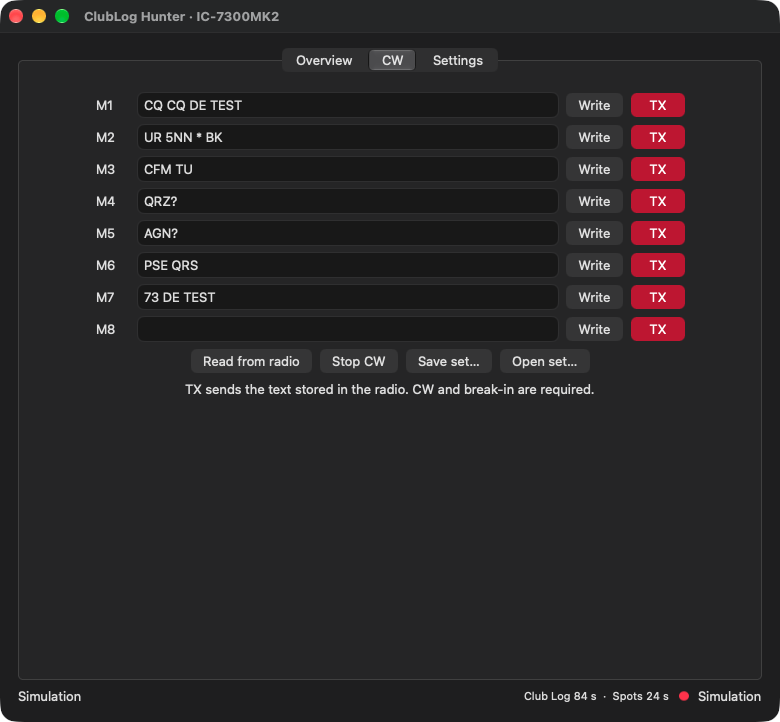

# ClubLog Hunter

ClubLog Hunter is a native macOS app for hunting amateur radio DXpeditions with an Icom IC‑7300MK2. It puts recent spots and worked band/mode combinations in one table. Click a supported frequency to tune the radio via CI‑V.


## Screenshots

The Overview and CW tabs shown with sample data.

| Overview | CW memories |
| --- | --- |
|  |  |

## Build and launch

You'll need macOS, the Xcode Command Line Tools, and Python 3 at `/usr/bin/python3`. The app uses Swift/AppKit and the Python standard library.

```sh
./build.sh
open "build/ClubLog Hunter.app"
```

The build produces a locally signed app bundle.

## Set up the radio

1. In **Settings**, select the radio's serial device, baud rate and CI‑V address. The factory address for the IC‑7300MK2 is `B6`. The serial device name depends on the Mac and USB connection.
2. If WSJT‑X already uses the first virtual USB port, configure **USB (B) Function → CI‑V** on the radio and select the second port for Hunter. Disable **Enable Tx** in WSJT‑X before retuning from Hunter.
3. Click **Connect radio**. Hunter reconnects on launch using the saved settings. The indicator in the bottom right shows the connection state. **Simulation** lets you try the controls without hardware.

## Hunt expeditions

- Enter your callsign and a Club Log REST API token in **Settings**, then click **Save settings**. Create the token in Club Log under **Settings → API**. Hunter stores it in the macOS Keychain.
- The expedition menu loads callsigns from Club Log with a QSO in the last seven days. Hunter restores the last selected expedition when it is available. The manually configured callsigns are available at startup before the first successful fetch.
- **Overview** displays spots from HamQTH for the last 30 minutes. A yellow cell shows a recent spot. A green cell shows a worked slot from Club Log and takes priority. Club Log groups digital modes under **Data**. The footer shows when the app will refresh each source.
- Click a spotted or saved frequency to tune **VFO A**. Option-click a cell to edit or remove a saved frequency. **Livestream web** opens the selected expedition's Club Log page.

## CW memories

Hunter loads M1–M8 after connecting. **Write** writes a memory and verifies it by reading it back. You can also save and reopen sets as JSON.

**TX** sends the text stored in the selected radio memory. It requires CW or CW‑R and Break-in. The CI‑V text command supports up to 30 characters. For longer messages or memories containing a contest-number placeholder `*`, send directly from the radio. **Stop CW** requests a stop.

## References

- [Icom IC‑7300MK2 CI‑V reference](https://icomuk.co.uk/files/icom/PDF/productAdditionalFile/IC-7300MK2_ENG_CI-V_0.pdf)
- [Club Log API reference](https://clublog.org/api/docs/index.php)
- [HamQTH developer documentation](https://www.hamqth.com/developers)

ClubLog Hunter is an independent project.
