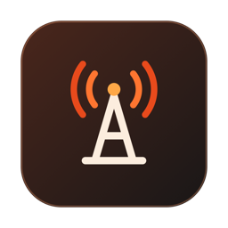
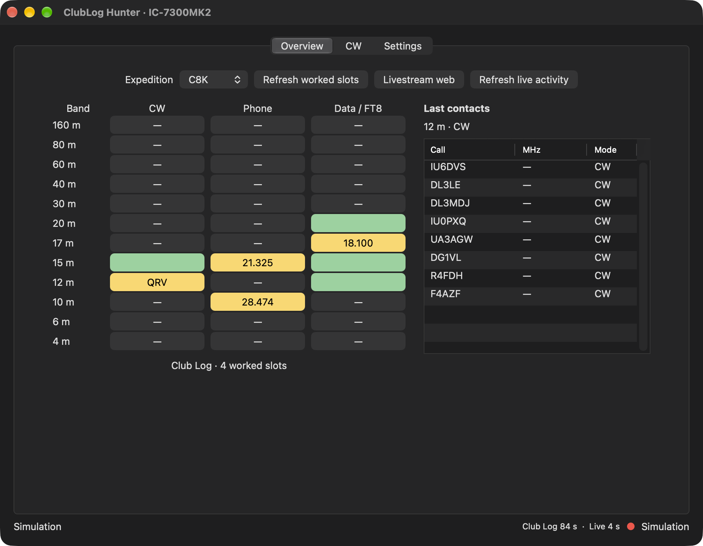

# ClubLog Hunter

ClubLog Hunter is a native macOS app for hunting amateur radio DXpeditions with an Icom IC‑7300MK2. It puts Club Log Livestream frequencies and your worked band/mode combinations in one table. Click a supported frequency to tune the radio via CI‑V.



## Screenshots

ClubLog Hunter 0.3.5 in simulation with sample data. The Overview shows the **Last contacts** panel filtered to **12 m CW**.

| Overview | CW memories |
| --- | --- |
|  |  |

## Build and launch

You'll need macOS, the Xcode Command Line Tools, and Python 3 at `/usr/bin/python3`. The app uses Swift, AppKit, WebKit, and the Python standard library.

```sh
./build.sh
open "build/ClubLog Hunter.app"
```

The build produces a locally signed app bundle.

## Set up the radio

1. In **Settings**, select the radio's serial device, baud rate and CI‑V address. The factory address for the IC‑7300MK2 is `B6`. The serial device name depends on the Mac and USB connection.
2. If WSJT‑X already uses the first virtual USB port, configure **USB (B) Function → CI‑V** on the radio and select the second port for Hunter. Disable **Enable Tx** in WSJT‑X before retuning from Hunter.
3. Click **Connect radio**. Hunter reconnects on launch using the saved settings. The indicator in the bottom right shows the connection state. **Simulation** lets you try the controls without hardware.

## Hunt expeditions

- Enter your callsign and a Club Log REST API token in **Settings**, then click **Save settings**. Create the token in Club Log under **Settings → API**. Hunter stores it in the macOS Keychain.
- The expedition menu loads callsigns from Club Log with a QSO in the last seven days. Hunter restores the last selected expedition when it is available. The manually configured callsigns are available at startup before the first successful fetch.
- **Overview** reads active band and mode combinations and their latest reported frequencies from the public Club Log Livestream. The app checks the page every five seconds. **Refresh live activity** checks immediately, and **Livestream web** opens the same page in your browser.
- **Last contacts** lists recent Livestream QSOs for the selected expedition, newest first. It follows the radio's band and Club Log mode group (CW, Phone, or Data). The app checks the radio every five seconds, including when you retune with the radio's controls. Each row shows the callsign, frequency in MHz when reported, and the logged mode. A dash marks a contact whose frequency was omitted.
- Yellow cells show live activity. A cell displays **QRV** when the livestream reports activity without a frequency. Green cells show your worked slots and take precedence over yellow. The live indication disappears when the slot goes inactive or live data becomes unavailable.
- Click a live frequency to tune **VFO A**. Click **QRV** to enter a frequency when the livestream omits it. While that slot is active, the saved frequency appears in the cell and can be clicked to tune. Hover over the cell to see that the frequency was entered manually. Option-click to edit or remove the saved frequency.
- In **Settings → Appearance**, select **Light**, **Dark**, or **System** to follow the macOS setting. Hunter remembers your choice.

## CW memories

Hunter loads M1–M8 after connecting. **Write** writes a memory and verifies it by reading it back. You can also save and reopen sets as JSON.

**TX** sends the text stored in the selected radio memory. It requires CW or CW‑R and Break-in. The CI‑V text command supports up to 30 characters. For longer messages or memories containing a contest-number placeholder `*`, send directly from the radio. **Stop CW** requests a stop.

## References

- [Icom IC‑7300MK2 CI‑V reference](https://icomuk.co.uk/files/icom/PDF/productAdditionalFile/IC-7300MK2_ENG_CI-V_0.pdf)
- [Club Log API reference](https://clublog.org/api/docs/index.php)

ClubLog Hunter is an independent project.
