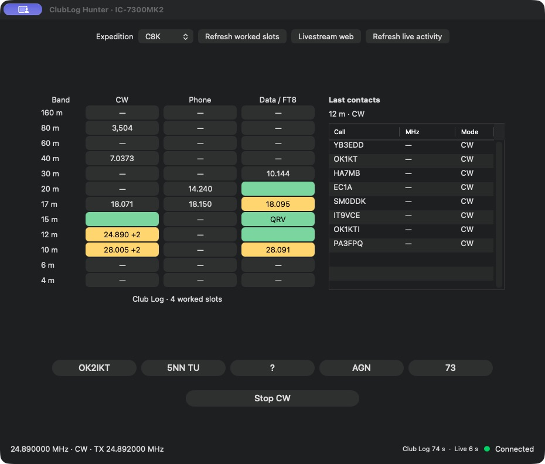
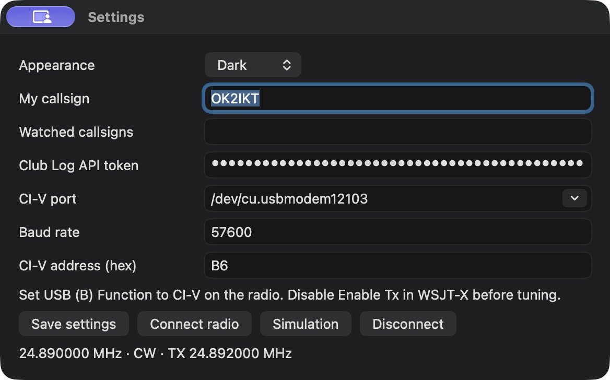

# ClubLog Hunter (helper) for IC-7300MK2

ClubLog Hunter is a native macOS app for hunting amateur radio DXpeditions with an Icom IC‑7300MK2. It shows Club Log Livestream frequencies, split offsets, and your worked band and mode combinations in one table. Click a supported frequency to tune the radio via CI‑V.


## Screenshots

Hunter in Dark appearance. The main window shows worked slots, the **Last contacts** panel, and the CW message controls. A CW cell showing `24.890 +2` tunes receive to 24.890 MHz and transmit to 24.892 MHz.



Open **ClubLog Hunter → Settings…** from the macOS menu bar to configure the radio, Club Log, and appearance.



## Build and launch

You'll need macOS, the Xcode Command Line Tools, and Python 3 at `/usr/bin/python3`. The app uses Swift, AppKit, WebKit, and the Python standard library.

```sh
./build.sh
open "build/ClubLog Hunter.app"
```

The build produces a locally signed app bundle.

## Set up the radio

1. Open **ClubLog Hunter → Settings…** (⌘,) and select the radio's serial device, baud rate and CI‑V address. The factory address for the IC‑7300MK2 is `B6`. The serial device name depends on the Mac and USB connection.
2. If WSJT‑X already uses the first virtual USB port, configure **USB (B) Function → CI‑V** on the radio and select the second port for Hunter. Disable **Enable Tx** in WSJT‑X before retuning from Hunter.
3. Click **Connect radio**. Hunter reconnects on launch using the saved settings. The indicator in the bottom right shows the connection state. **Simulation** lets you try the controls without hardware.

## Hunt expeditions

- Enter your callsign and a Club Log REST API token in **Settings**, then click **Save settings**. Create the token in Club Log under **Settings → API**. Hunter stores it in the macOS Keychain.
- The expedition menu loads callsigns from Club Log with a QSO in the last seven days. Hunter restores the last selected expedition when it is available. The manually configured callsigns are available at startup before the first successful fetch.
- **Overview** reads active band and mode combinations and their latest reported frequencies from the public Club Log Livestream. The app checks the page every five seconds. **Refresh live activity** checks immediately, and **Livestream web** opens the same page in your browser.
- **Last contacts** lists recent Livestream QSOs for the selected expedition, newest first. It follows the radio's band and Club Log mode group (CW, Phone, or Data). The app checks the radio every five seconds, including when you retune with the radio's controls. Each row shows the callsign, frequency in MHz when reported, and the logged mode. A dash marks a contact whose frequency was omitted.
- Yellow cells show live activity. A cell displays **QRV** when the livestream reports activity without a frequency. Green cells show your worked slots and take precedence over yellow. The live indication disappears when the slot goes inactive or live data becomes unavailable.
- Click a frequency in the table to tune VFO A. Right-click a slot to save or edit its manual frequency. Click the saved cell to tune it, or use **Tune saved frequency** in its edit dialog when a live frequency takes precedence. For CW and Phone, `14.055 +5` means receive at 14.055 MHz and transmit at 14.060 MHz on VFO B. A negative offset works the same way. Data / FT8 always turns the radio's split off. CW and Phone turn it off when no offset is available.
- Hunter checks [HamQTH](https://www.hamqth.com/dxc) for recent spots for the selected expedition. When the callsign, mode, band and receive frequency match, an explicit hint such as `UP 5`, `DOWN 2`, or `QSX 14060` appears beside the livestream frequency. A manual offset saved for the same receive frequency takes priority. Bare `UP` and ranges do not select a transmit frequency.
- In **Settings → Appearance**, select **Light**, **Dark**, or **System** to follow the macOS setting. Hunter remembers your choice.

## CW messages

Right-click one of the five CW buttons below the tables in **Overview** to edit its message. Hunter stores the messages locally. Left-click a button to send its text directly via CI-V, up to 30 characters. Sending a message leaves the radio’s M1–M8 memories unchanged. The radio must be in CW or CW-R with Break-in enabled. Click **Stop CW** below the message buttons to stop transmission.

## References

- [Icom IC‑7300MK2 CI‑V reference](https://icomuk.co.uk/files/icom/PDF/productAdditionalFile/IC-7300MK2_ENG_CI-V_0.pdf)
- [Club Log API reference](https://clublog.org/api/docs/index.php)

ClubLog Hunter is an independent project.
